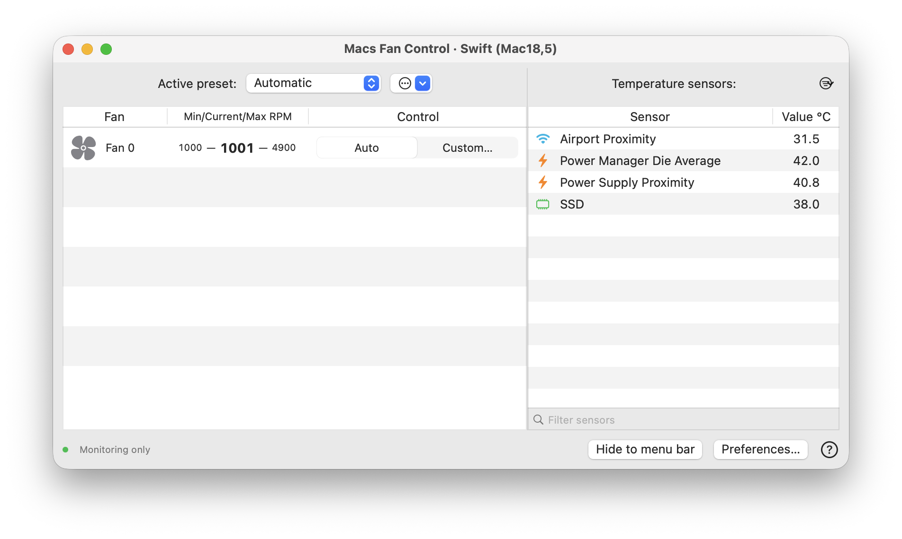
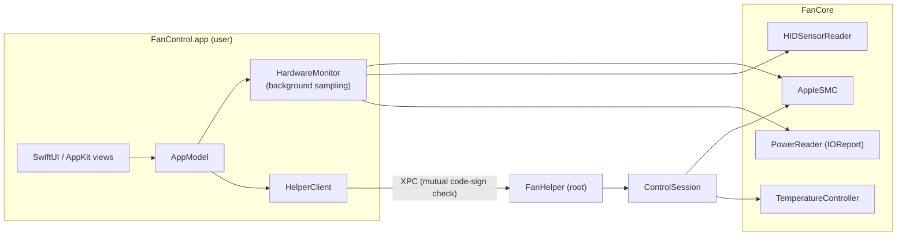

<div align="center">

# Macs Fan Control

**A native, open-source fan control and hardware monitoring app for macOS — written in Swift.**

Monitor every temperature, voltage, current, and power channel your Mac exposes, and take manual control of your fans through a code-signed privileged helper.


**English** | [简体中文](README.zh-CN.md)



</div>

---

## Table of Contents

- [Highlights](#highlights)
- [Requirements](#requirements)
- [Quick Start](#quick-start)
- [Enabling Fan Control](#enabling-fan-control)
- [Features](#features)
- [Architecture](#architecture)
- [Safety](#safety)
- [Known Limitations](#known-limitations)
- [Development](#development)
- [Acknowledgements](#acknowledgements)
- [Disclaimer](#disclaimer)

## Highlights

- 💻 **M6 support** — sensor reads and the GUI tested on Mac mini M6 (`Mac18,5`); real fan-speed writes and recovery still need hardware validation.
- 🌀 **Fan control** — constant RPM or sensor-based curves, applied live while you drag the slider.
- 🌡️ **Full telemetry** — enumerates all SMC `T*` / `V*` / `I*` / `P*` keys, HID sensors, and IOReport Energy Model channels (428 channels on a `Mac18,5`).
- 📊 **Menu bar** — fan RPM and any sensor reading in fixed-width slots that never jitter.
- 🔐 **Secure helper** — root XPC helper with mutual code-signature verification; no paid developer account required.
- 🛟 **Fail-safe** — hands fans back to the system on sensor failure, write errors, disconnects, heartbeat timeout, sleep, and quit.
- 🧪 **Demo mode** — explore the whole UI with simulated fans without touching hardware.
- 📦 **Zero dependencies** — built with native macOS frameworks.

## Requirements

| | |
| --- | --- |
| OS | macOS 13 Ventura or later |
| Toolchain | Xcode / Swift 5.9 or later |
| Hardware | Apple Silicon, including M6 (sensor reads and GUI tested on Mac mini M6, `Mac18,5`); Intel hardware support is untested |

## Quick Start

Download a packaged app from [Releases](https://github.com/localhost-copilot/macs-fan-control-re/releases): `arm64` for Apple Silicon (including M6), or `x86_64` for Intel. Builds are ad-hoc signed and not notarized. To build from source:

```sh
git clone <repository-url> macs-fan-control
cd macs-fan-control

swift test                          # run unit tests
bash scripts/build-app.sh           # build and ad-hoc sign the .app
open "dist/Macs Fan Control Swift.app"
```

You can also open `Package.swift` directly in Xcode.

### Try it without hardware access

```sh
# Full interactive demo with two simulated fans — never writes to hardware
open -n "dist/Macs Fan Control Swift.app" --args --demo
```

### Command-line probing

```sh
# Read-only dump of fans, temperatures, voltages, currents, and power, then exit
swift run FanControl --probe

# Full inventory as JSON, including unavailable channels, raw HID values, and backing SMC keys
swift run FanControl --probe-json
```

## Enabling Fan Control

Reading sensors needs no privileges. Writing fan speeds requires a privileged helper, which the packaged app installs automatically on launch or the first time you change a fan. macOS asks for administrator authorization once. Status and removal live in **Preferences → Advanced**.

### Ad-hoc builds (default)

The default local build installs a root-owned copy of the app plus a LaunchDaemon. It stages the files in a root-only temporary directory, verifies the exact code-signature hashes (cdhash) of the app and helper, then registers the service. The XPC connection is bound to the current build in both directions, so **re-enable the helper after every rebuild**.

Installed files:

```
/Library/PrivilegedHelperTools/local.macsfancontrol.swift.helper.app
/Library/LaunchDaemons/local.macsfancontrol.swift.helper.plist
```

### Team-signed builds

With an Apple team signing identity, the helper is installed through `SMAppService` instead:

```sh
SIGNING_IDENTITY='Developer ID Application: YOUR NAME (TEAMID)' bash scripts/build-app.sh
# An Apple Development identity also works for testing.
```

Move the app to a stable location (for example `/Applications/Macs Fan Control Swift.app`), enable the helper, and approve it under **System Settings → General → Login Items**. The app and helper must share a Team ID. Before switching installation methods, remove the old helper with **Remove helper…** from the previous build.

### Removing the helper

**Preferences → Advanced → Remove helper…** restores automatic control first, then unregisters the service.

> [!WARNING]
> Do not let another fan control tool drive the same fan at the same time.

## Features

<details open>
<summary><b>Main window & fan control</b></summary>

- Resizable two-pane window: fans (min / current / max RPM, Auto / Custom) and sensors, with double-click and context menus.
- **Constant RPM** via slider or numeric input.
- **Sensor-based** control with start / max temperatures, live curve preview showing the current operating point, and input validation.
- Changes take effect immediately; **Cancel** restores the previous settings.
- Presets: Automatic, Full blast, and custom presets (save / rename / delete / apply). Presets persist, but the app never re-applies hardware control on its own at launch.

</details>

<details>
<summary><b>Menu bar</b></summary>

- Monochrome, color, or no icon; fan RPM and a chosen sensor reading.
- Fixed-width value slots so the item never shifts as numbers change.
- Color icon turns orange under manual control; high temperatures are highlighted.
- Preset switching, per-fan control, show / hide window, and quit.

</details>

<details>
<summary><b>Sensors & telemetry</b></summary>

- **SMC**: automatic enumeration of `T*` / `V*` / `I*` / `P*` keys, supporting float and valid signed / unsigned 16-bit fixed-point encodings. Unknown keys and unavailable states are kept; rediscovery runs every minute.
- **HID**: temperature, voltage, and current. Same-named PMU channels are disambiguated by `LocationID`; electrical channels with broken HID encoding are read through their matching SMC key. Raw HID values are retained for diagnostics.
- **IOReport Energy Model**: every discoverable channel, converted to watts from two energy samples. The first sample, counter resets, and sleep gaps show a waiting state. Overlapping channels are never summed into a fake system total.
- Classified by type, unit, source, channel count, and unavailability reason. Only valid temperatures can drive fan curves.
- Default list shows named sensors and group averages; **Show all raw channels** reveals everything. `Mac18,5` additionally gets *inferred* CPU / GPU averages.

</details>

<details>
<summary><b>Preferences</b></summary>

- Toolbar-style window: **General**, **T° Sensors**, **Menu bar display**, and **Advanced** (helper management and diagnostics).
- Launch at login minimized, Dock icon toggle, Celsius / Fahrenheit, precise readings, sensor visibility.
- English and Simplified Chinese UI.
- Local ZIP diagnostics export — nothing is uploaded and disk serial numbers are not collected.

</details>

## Architecture



```
Sources/
├── FanCore/        SMC ABI, HID reader, IOReport power, model database, controller, control session, XPC protocol
├── FanControl/     App: AppModel, HardwareMonitor, HelperClient, LocalHelperInstaller,
│                   MainView, FanControlSheet, CurvePreview, PreferencesView, StatusItemRenderer, Theme
└── FanHelper/      Signed root XPC service; serializes hardware access, ticks every 1.5 s
Tests/
├── FanCoreTests/   Decoding, input bounds, controller clamping, stale fallback, sensor failure, partial write recovery
└── FanControlTests/ App and installer tests
scripts/
├── build-app.sh    Build, bundle, and sign the .app
└── make-icon.swift App icon drawn in code
docs/
├── VALIDATION.md   What was actually verified, and what was not
└── REFERENCE.md    Implementation notes, API references, and resource provenance
```

The helper supports Apple Silicon M6-style `F{i}md` / `F{i}Md` mode keys as well as the legacy `FS! ` key, and writes target RPM.

## Safety

The app is designed to fail toward the system's automatic fan control:

| Event | Behavior |
| --- | --- |
| Sensor driving a curve fails | Fan returns to automatic |
| SMC write fails | Fan returns to automatic; restore retried until it succeeds |
| Client disconnects / heartbeat times out | Helper releases all fans |
| Helper receives `SIGTERM` | Fans restored to automatic |
| System sleep or app quit | App releases the fans it controls |
| App launch | Manual control is **never** restored automatically |

Closing the main window only hides the app to the menu bar; quitting releases control.

## Known Limitations

- **Unofficial.** This is an independent project and is not affiliated with CrystalIDEA.
- **Controller** implements temperature bands, directional hysteresis, ramping, and 31 s refresh.
- **Storage / external sensors.** SSD temperature comes from system HID / NAND channels. Separate SATA / NVMe SMART, Thunderbolt disks, and eGPU temperatures are not implemented.
- **"All" means publicly enumerable.** Firmware-hidden sensors are inaccessible. HID and SMC may expose the same physical sensor, so the channel count is not the number of physical sensors. CPU / GPU grouping on `Mac18,5` (`Tp*` / `Te*` / `Tg*`) is inferred.
- **Low temperatures.** Some Apple Silicon hardware refuses to spin fans up manually when cold.
- **Localization.** English and Simplified Chinese only.
- **Not notarized.** Build, unit tests, live sensor reads, and GUI are verified. Admin install, real RPM writes, Intel and other Apple Silicon models, and post-sleep recovery still need real-hardware testing. See [`docs/VALIDATION.md`](docs/VALIDATION.md).

## Development

```sh
swift build                         # debug build
swift test                          # run all tests
CONFIGURATION=debug bash scripts/build-app.sh
```

| UserDefaults domain | Used by |
| --- | --- |
| `local.macsfancontrol.swift` | Normal launches |
| `local.macsfancontrol.swift.demo` | `--demo` launches |

In demo mode, **Use real sensors** in the main window switches back to real hardware.

Contributions are welcome. Please keep hardware writes behind the helper, add tests for new decoding or control logic, and record real-hardware verification in `docs/VALIDATION.md`.

## Acknowledgements

- [Macs Fan Control](https://crystalidea.com/macs-fan-control) by CrystalIDEA — inspiration for the interface and interaction design.
- [Stats](https://github.com/exelban/stats) — reference for HID usage pages, event types, and IOReport signatures.
- [Chromium `m1_sensors_mac.mm`](https://chromium.googlesource.com/chromium/src/+/refs/tags/123.0.6285.0/components/power_metrics/m1_sensors_mac.mm) — IOKit HID C signatures.
- [Mac-mini-M6-fan-control-LLM](https://github.com/HDZucht/Mac-mini-M6-fan-control-LLM) — notes on the lowercase `F0md` mode key.

See [`docs/REFERENCE.md`](docs/REFERENCE.md) for details.

## Disclaimer

> [!CAUTION]
> This software talks to private, undocumented SMC / HID interfaces that are not stable macOS SDK contracts. Changing fan speeds can affect thermals and hardware lifespan. **Use at your own risk**, and verify reading, authorization, and recovery on your own model before relying on it.

The five XML files in `Sources/FanCore/Resources` (sensor names, model aliases, and fan locations) come from CrystalIDEA's Macs Fan Control. They are **not** original to this project and no redistribution license is claimed for them. All Swift source code is an independent implementation.

"Macs Fan Control" is a trademark of CrystalIDEA Software. This project is not affiliated with or endorsed by CrystalIDEA.
